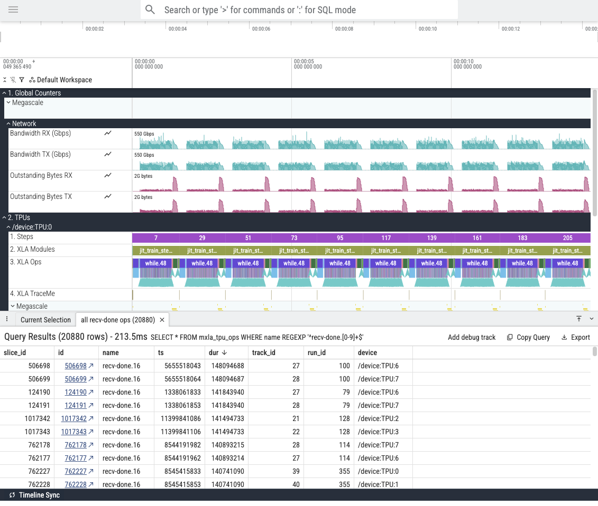
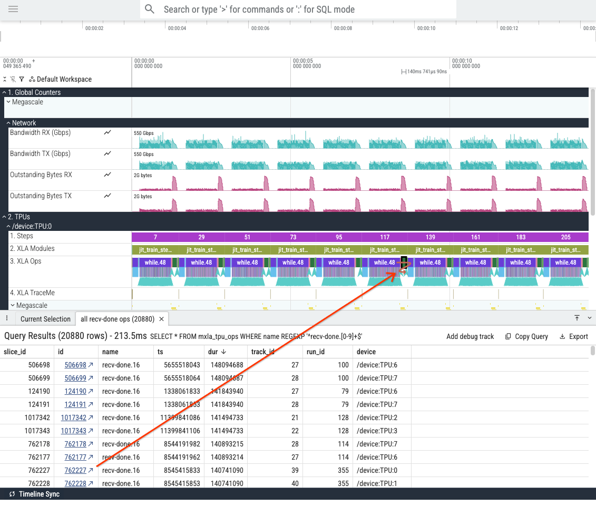
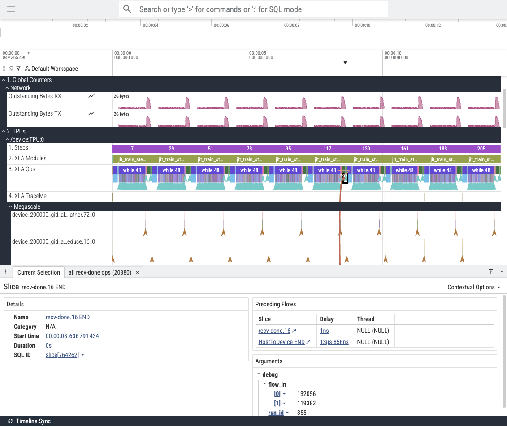
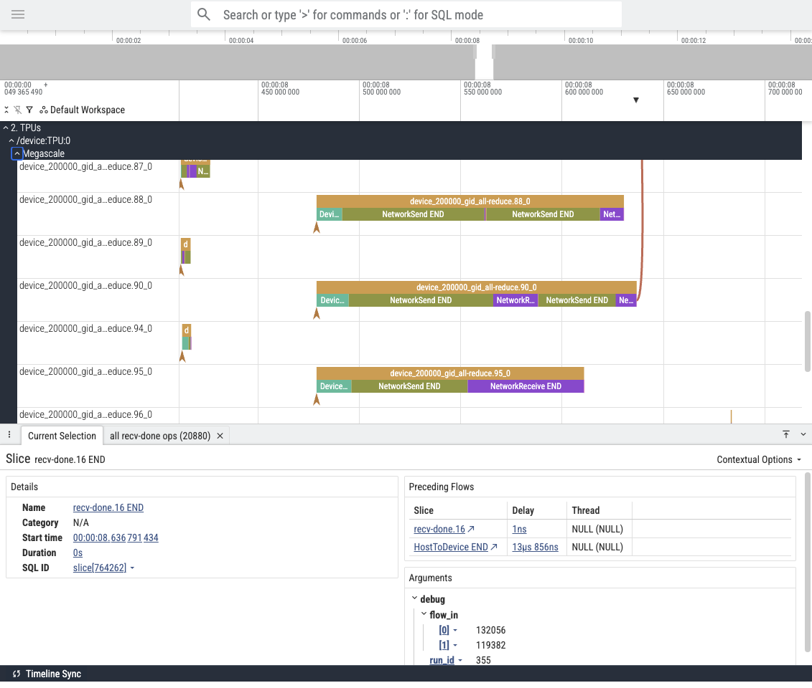
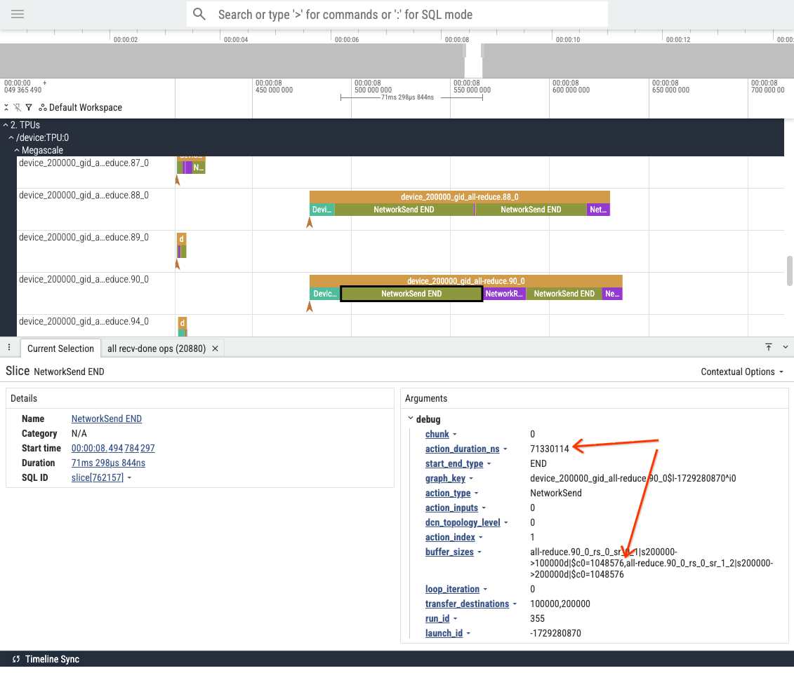
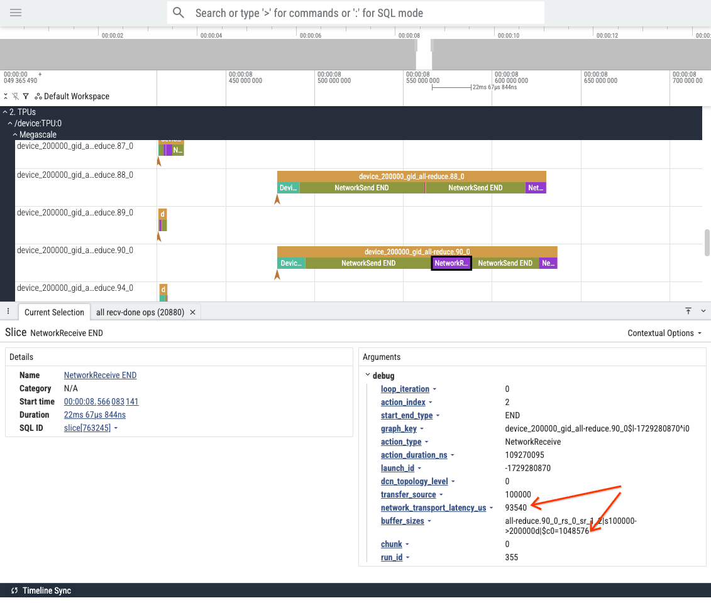
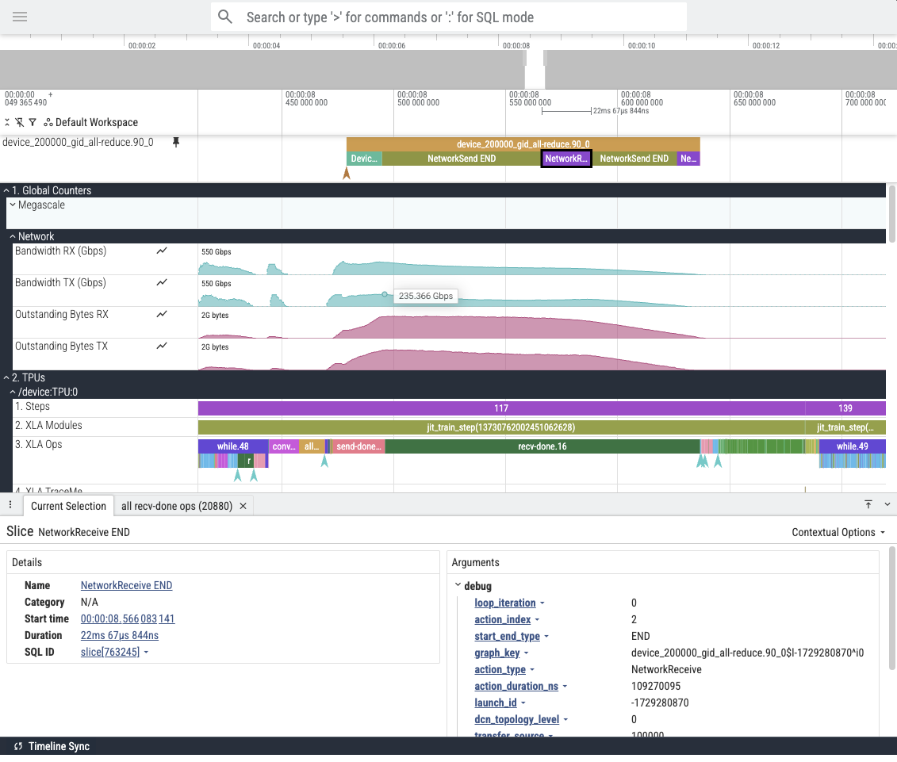
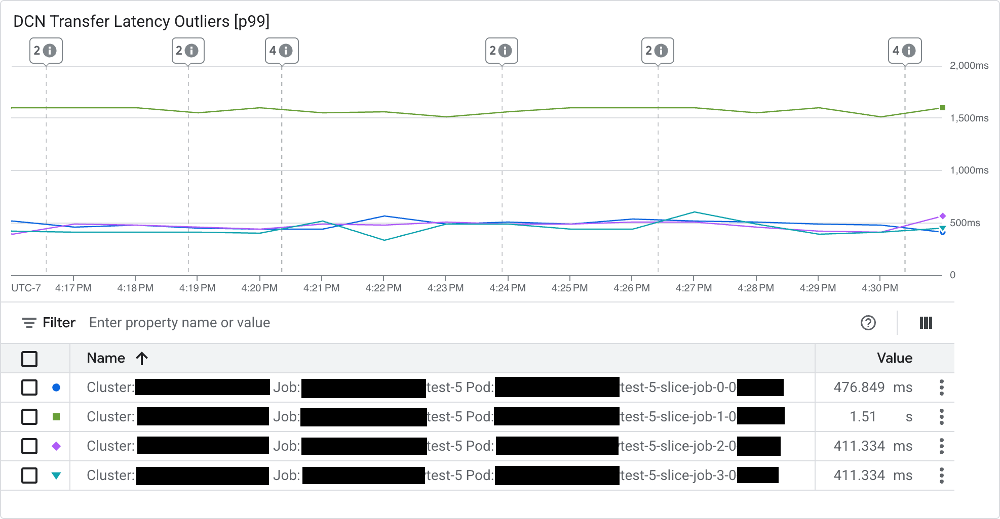
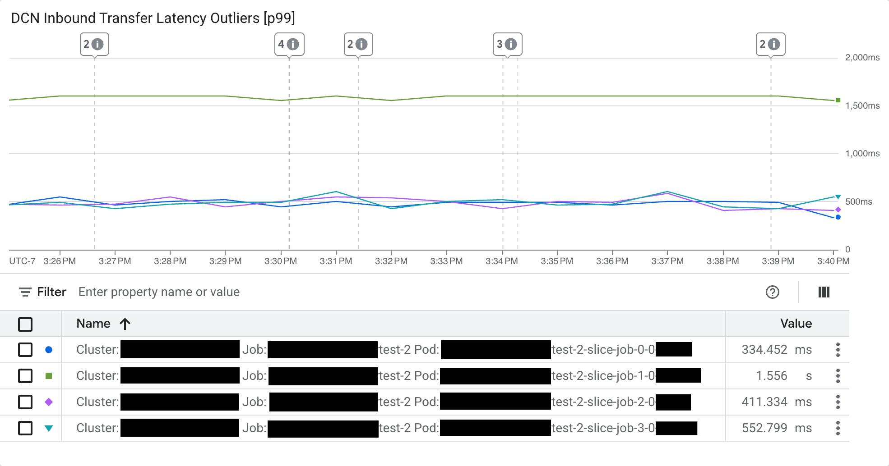
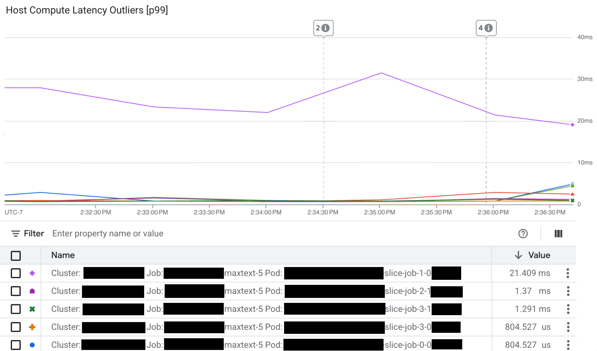

# Debugging Workflow

Cloud TPU Multislice environments are composed of multiple TPU slices that
communicate over the Data Center Network (DCN). Multislice workloads use
Megascale collectives to communicate over DCN. These guides discuss how to
identify and diagnose sources of performance issues such as slowness, hangs or
errors in a multi-slice job driven by Megascale.

## Prerequisites

1.  Use JAX 0.6 or up, and enable JAX distributed service. This version of JAX
    contains additional logging that can help identify which workers are
    experiencing issues.
2.  (Optional) Generate an HLO dump using the --xla_dump_to flag when
    initializing your workload. This is discussed in the [XLA
    documentation](https://openxla.org/xla/hlo_dumps).
3.  (Optional) Set `--vmodule=real_program_continuator=1` to enable verbose
    logging for the TPU program execution status.

## Flow chart

The flowchart below illustrates the debugging process. To access detailed
playbooks for each step, click on the corresponding item in the chart.

<iframe src="flow_chart.svg" width="1000" height="2000" style="border: none;"></iframe>

<!-- linter style off -->

## Hangs

A Megascale *hang* occurs when a worker has waited on a Megascale communication
operation for a set timeout period. In this situation, you will see a Megascale
`HANG_DETECTED` message in your Cloud TPU logs, and it presents as a
failure/error. Because Megascale is responsible for communicating over DCN, the
hang is generally first detected and reported by Megascale. However, this does
not necessarily mean that the error is related to Megascale itself. Most often,
hang detection is a symptom of a problem in another part of the system (e.g.
unexpected job restarts, hardware errors, executable mismatches).

In this way, we can think of the Megascale `HANG_DETECTED` message as an
indication that your workload is not progressing properly. This could be caused
by Customer-owned software, Google-owned software, or an issue with the
hardware. This guide will help you determine which layer is causing the workload
issue.

### Locate the Megascale Hang Detected Error

RapidEye is a system that aims to diagnose hangs that impact ML workloads that
run on Pathways and McJAX. RapidEye is enabled by default for all multislice
workloads.

In RapidEye, a digest is generated when a Megascale hang occurs. When Megascale
detects a hang in your workload, the first step is to locate the `Megascale
detects a hang` message in your logs.

1.  Workers will report errors to a coordinator for processing.
    *   For **Pathways** jobs, the digest can be found in the logs of
        `resource_manager` job.
    *   For **McJAX** jobs, the logs can be found on MXLA Coordinator. This is
        typically task 0 of slice 0.
2.  Check your logs around time of error detection, and look for the `Megascale
    detects a hang` message.
3.  Follow steps below to diagnose the issue based on the identified cause.

### Diagnosis

#### Interpreting TPU States

Before diagnosing MXLA hangs, it is important to understand the TPU states
report format. Below is a sample report:

```text
Full error digest:
  Potential cause: <determined_cause>
  Potential culprit workers: <task_name>
  First error timestamp: <timestamp>
  First error type: <error_type>
  TPU states:
    Launch ID: <launch_id>
    Module: jit.step_fn Fingerprint: <fingerprint>
      Sample worker: <task_name>@<host_name>:<tpu_chip>:<tpu_core>
    Tag:PC breakdown:
      <num_cores>@<location>(HLO): [<task_name>:<host_name>@<tpu_chip>:<tpu_core>, ...]
      ...
```

#### Bad TPU Chip (TensorCore or SparseCore)

**Error message:**

```text
Megascale detects a hang that is likely caused by bad TPU chips on the following hosts. Please remove the hosts from the fleet and restart the workload. If problem persists please contact Megascale XLA team.
  The host that have bad TPUs are: <host_name>
  Full error digest:
    Potential cause: Bad TPU chips
    Potential culprit workers: <job_name>/<task_id>:<host_name>
```

This error means that the issue is potentially caused by a faulty TPU chip. The
error message should include the job information and host name of the faulty
chip. In the example above, the faulty chip is on host `<host_name>`, affecting
task `<task_id>` of the job `<job_name>`. You can configure your job to avoid
that host.

**Note:** In some cases, the hang can be caused by an XLA or custom
Pallas kernel bug, but if you see the same host appearing multiple times (for
example more than 3 times) in multiple hang events, the TPU on that host is very
likely faulty.

#### Networking Issues

**Error message:**

```text
Megascale detects a hang that is likely caused by a networking issue. Please examine the underlying networking stack for the following hosts.
  The hosts are: <host_name>
  Full error digest:
    Potential cause: Networking issue
    Potential culprit workers: <host_name_1>, <host_name_2>
```

This error indicates that your job has encountered a failed network link. The
error message should include a single or pair of job name, task id, host name of
the faulty network link. In the example above, the faulty network link is
between host `host_name_1` and `host_name_2`. Sometimes RapidEye can further
localize the faulty host if a single host appears in multiple broken network
links.

#### Different Modules

**Error message:**

```text
Megascale detects a hang that is likely caused by running different modules on different devices. Please confirm that all workers is running the exact same program. It can also be caused by a hang in a subset of devices and the unaffected devices have moved on to the next program. Please inspect the digest below to further root cause the hang.
Example hosts that have different HLO modules: <host_name>
Full error digest:
  Potential cause: Different module
  Potential culprit workers: <host_name>
  TPU stats:
    <host_name>: <pc>
  TPU states:
    Module: jit_loss_and_grad
    Fingerprint: <fingerprint>
    Launch ID: 193
      <tag>:<pc>(<hlo>): <host_name>
    Module: jit_optimizer_apply
    Fingerprint: <fingerprint>
    Launch ID: 0
      <tag>:<pc>(<hlo>): <host_name>
```

This error may indicate that a hang has occurred in a subset of workers, causing
those workers to be stuck at the current module while unaffected workers advance
to the next module. To identify the root cause, inspect the digest printed by
RapidEye in the logs.

The `TPU states` section of the logs shows which modules are running on which
workers. In the example above, workers are running different modules:
`jit_loss_and_grad` and `jit_optimizer_apply`.

#### Fingerprint Mismatch for HLO Module

**Error message:**

```text
Megascale detects a hang that is likely caused by inconsistent HLO module compilation across workers. This is likely a bug in JAX tracing or XLA compiler. Please inspect the HLO dumps to confirm the root cause.
  Example hosts that have different HLO fingerprints: <host_name>
  Full error digest:
    Potential cause: Fingerprint mismatch
  Potential culprit workers: <host_name>
  TPU stats:
    Module: reduce.31
    Fingerprint: <fingerprint_1>
    Launch ID: 37
      <tag>:<pc>(<hlo>): <host_name>
    Module: reduce.31
    Fingerprint: <fingerprint_2>
    Launch ID: 40
      <tag>:<pc>(<hlo>): <host_name>
```

This log message indicates the hang was likely caused by inconsistent HLO module
compilation across workers, possibly due to an issue with JAX tracing or the XLA
compiler. If you see this log, follow [these
steps](https://openxla.org/xla/hlo_dumps) to collect HLO dumps from the culprit
workers for further debugging. You may need to upload the dump to GCS
in order to share them with the XLA or Megascale team.

#### Data Input Stall

**Note:** This error is not yet implemented.

```text
Megascale detects a hang that is likely caused by data input stall on the
following hosts. Please check the workers to make sure the data input pipeline
is working properly.
  The host that have data input stalls are: <host_name>
```

This error means that all devices launched the same program, but that input data
was not provided to the program before the system timed out. To fix this issue,
confirm that:

1.  The identified hosts can access the input data source.
2.  The identified hosts are properly loading/parsing the input datasource.
3.  Confirm identified hosts are not throttled on reads to the input datasource.

#### Unrecoverable Error

**Error message:**

```text
Some workers have halted with an unrecoverable error:
  <worker> : {some error}
  Please inspect the error log of these workers:
  <worker>
```

This error means that there was an issue that prevented the program from
properly executing and could not be recovered automatically. This error was
unable to be specifically categorized. Further information can be obtained from
checking the logs of the worker(s) mentioned in the error report.

If the error appears to be specific to the given machine (ex. failure to copy
data from TPU to host), then you can configure your job to avoid those hosts.

#### Unknown Error

**Error message:**

```text
Megascale detects a hang but cannot determine the root cause. Please inspect the
full digest below.
```

This error means that there was an issue that prevented the program from
properly executing and could not be recovered automatically. This error was
unable to be specifically categorized and there is no further error information
available. If RapidEye cannot identify the culprit, follow the [Manual Diagnosis
](#manual-diagnosis) instructions below.

### Manual Diagnosis

Always inspect the [RapidEye diagnosis](#diagnosis) first when investigating a
hang. Only use the manual diagnostic flags below as a fallback when RapidEye
cannot identify the culprit—such as unknown MXLA hangs, single-slice hangs, or
exceptionally slow step times.

#### Diagnostic Flags Reference

When diagnosing stalls, timeouts, or program stragglers that RapidEye cannot
automatically classify, the following flags enable detailed low-level execution
logs and prevent premature job crashes:

```bash
# Enable low-level logging for TensorCore and SparseCore execution states
--xla_tpu_enable_log_recorder=true
--xla_tpu_enable_sc_log_recorder=true

# Extend synchronization wait timeouts to prevent false-positive stall
# detections
--xla_tpu_debug_sflag_wait_timeout_ms=150000
--xla_tpu_debug_sc_sflag_wait_timeout_ms=150000

# Prevent immediate hard crash upon timeout detection so logs can be gathered
--xla_tpu_debug_sflag_wait_shalt_on_detection=false

# Enable hierarchical tracking of HLO progress
--xla_tpu_enable_progress_tracker=16

# Prevent the coordinator from aborting all workers prematurely on hang
--megascale_error_reporter_abort_on_hang=false
```

#### Purpose and Usage

- **Preventing Premature Aborts**: By default, when a hang is detected, the
  coordinator immediately aborts all workers
  (`megascale_error_reporter_abort_on_hang=true`). Setting this flag to `false`
  keeps workers alive long enough to flush thread stack traces and detailed TPU
  states to Cloud Logging.
- **Investigating Slow Steps vs. Real Hangs**: For exceptionally large models or
  initialization steps that take longer than the default timeout (typically 60
  seconds), increasing `--xla_tpu_debug_sflag_wait_timeout_ms=150000` (150s)
  rules out false positives.
- **Inspecting Timeout Logs**: In Cloud Logging, search for:
  ```text
  Wait timeout on sflag
  ```
  Group matching logs by HLO opcode to isolate the first worker or core that
  failed to make progress, distinguishing the culprit from bystander workers
  waiting on dependencies.

<!-- linter style on -->

## Performance

Typically, slowness is observed in one of multiple forms:

1.  Sharp or gradual slowness after a certain amount of steps
2.  Consistent slowness compared to a baseline
3.  Periodic slowness

Depending on the type of slowness observed, different tools are required to
diagnose.

If the slowness begins after a certain number of steps have been completed, it
is very likely that something in the overall system has changed since the first
step. Eliminate most suspicion centered on compute latencies on CPU, the PCIe
data transfer between TPUs and host, and network slowness by checking the logs.

For any of the first three bullet points, if the latency jumps or the throughput
drops at the same point the start of the slowness was observed, the next step
would be to look at the network, hardware, or Eigen configuration and possibly
the [XProf profiler tool](https://openxla.org/xprof) for further analysis.

If the collective end-to-end latency is larger than expected, but the other
latencies look normal, the slowness could most likely be attributed to increased
contention over host resources or networking issues. On the other hand, if the
collective end-to-end latency looks normal, the slowness could be related to
other parts of the TPU program. Both cases warrant a look at XProf.

For an in-depth reference on configuring and tuning Megascale flags (such as
collective buffer sizing and zero-copy memory premapping), see the
[Megascale Performance Tuning Flags guide](performance_tuning.md).

### Get an XProf Session

Follow the instructions in the [XProf
documentation](https://openxla.org/xprof/capturing_profiles) to generate an
XProf trace for your problematic run.

### Check for shortage of mapped DMA buffers

The Megascale XLA runtime needs to register host memory before it can be used
for DMAs to and from the TPU. This happens early after the process starts. If
you see these registrations (`MapDmaBuffer` calls) at steady-state then it
indicates that something is wrong. Look for the presence of these calls in XProf
Trace Viewer. See the screenshot below for reference.

**Tip:** Search for the exact worker name, because there can be other workers
with similar or close names. You also search for the term “MapDmaBuffer” on the
page.


If the issue is observed then try to increase the size of the premapped memory
region by increasing the value of `--megascale_grpc_premap_memory_bytes`,
restarting the job, then checking again. Please also check the checkpoint size:
the general guidance is that the premap buffer should be at least twice the
checkpoint size.

### Check for memory copies during network transfers

Megascale XLA network transfers are zero-copy by design. However, there are
cases where memory copies will occur and cause degraded performance. Look for
memory copies in Megascale's "Communication Transport" traces as shown in the
example screenshot below.


If the issue is observed then try to increase the size of the premapped memory
region by increasing the value of `--megascale_grpc_premap_memory_bytes`,
restarting the job, then checking again. Please also check the checkpoint size:
the general guidance is that the premap buffer should be at least twice the
checkpoint size.

### Network Analysis

By analyzing collective slack, network throughput, and RPC latencies in XProf,
you can determine whether your workload is limited by insufficient
compute-communication overlap, saturated network bandwidth, or elevated
transport latency.

#### High Network Bandwidth Demand

If you are observing long `recv-done` op latencies within your model's XProf,
this could be an indication that your model is "bandwidth bound" in those
portions of the step function (i.e. the model is blocked by available network
bandwidth in the system).

You can check this in
[XProf Megascale Viewer](https://openxla.org/xprof/megascale_viewer) by zooming
in on a part of the trace where you see long `recv-done` ops then examining the
"Network" counter track at the top of the trace (under "Global Counters"). If
the reported network bandwidth there (which is an estimate) is close to the
theoretical maximum of your machine then it indicates a network bandwidth
bottleneck.

Below is a step-by-step example where we identify slow `recv-done` ops then show
that they occur during periods of very high network bandwidth utilization,
meaning that network latency is what's likely driving their slowness. In this
case, the maximum bandwidth of the profiled machine is 200 GiB/s.

<section class="zippy" markdown="1">
Step-by-step example

1.  Use the [recv-done ops
    query](https://openxla.org/xprof/megascale_viewer_sql#recv-done_ops) to list
    all recv-done ops, then sort by duration column to find the longest ones.
    **Note**: It could make sense to first use the "recv-done stats" query to
    see statistics. If the main goal is reducing step time, then sorting by
    `duration_ns_sum` would give us the ops that are driving step time the most.
    We could then use the "recv-done ops" query and modify it to restrict the op
    name in order to find the longest instances of that op.
    
    In this case, we see that several instances of `recv-done.16` are more than
    140 milliseconds long, which is very long given that the step time here is ~
    740 milliseconds.
2.  Click on the id of one of the instances to jump to it in the timeline. We
    choose the one on TPU:0 to avoid scrolling.
    
3.  Switch to the "Current Selection" tab in the bottom panel. Here, you can see
    some information about this recv-done instance. Now click on the
    'recv-done.16 END' event under "Following Flows". This will show a line
    going down to the respective megascale action graph trace.
    
4.  Scroll down to the action graph. Observe that it took ~ 158 milliseconds.
    Some of this time was overlapped with TPU computation which is why the
    recv-done (140 ms) is shorter than that duration. We see that the latency is
    mostly driven by two slow network sends (accounting for 71 + 38 = 109
    milliseconds) and two network receives. (accounting for 22 + 10 = 32
    milliseconds)
    
5.  Click on the slowest NetworkSend. Observe that the action took 71
    milliseconds to transfer 1 MiB to one peer and to the same worker
    (loopback). This is very slow.
    
6.  Click on the slowest NetworkReceive. Observe that it took 93 milliseconds to
    transfer 1 MiB. This is also very slow.
    
7.  Pin this line to the top of the page by clicking the pin icon which appears
    when the mouse hovers near the track name (left hand side). This allows
    viewing the network bandwidth utilization at the time that this action
    graph was executing. Here, we observe that the (estimated) network bandwidth
    utilization is close to or above the theoretical limit during the time that
    the slow network sends and receives occur. This indicates that the slowdown
    here is caused by network bandwidth bottleneck.
    
</section>

To mitigate bandwidth bound models, you can:

1.  Check the [Collective Slack](#collective-slack-too-small) of your model.
    Models with many collectives with low slack will have bandwidth bound
    regions.
2.  Confirm that the network settings are optimized.
3.  Examine your model structure and data sharding to see if there are ways to
    increase computation/communication overlap.
4.  (Data parallel models) Confirm that you have sufficient batch size in each
    local replica to overlap with the communication.

#### High Network Latency

If the bandwidth is not saturated, you can also examine network latency in the
[XProf Megascale Viewer](https://openxla.org/xprof/megascale_viewer). If you see
that RPC latencies are constantly or sporadically high, this means that there
are some issues with the MXLA RPCs.

#### Collective Slack Too Small

One indicator that your workload is not optimized for compute/communication
overlap is seeing small slack times for a subset of collectives. This can
manifest as longer than expected `recv-done` traces in the trace viewer, or as
collectives with zero or near-zero [slack
time](https://cloud.google.com/tpu/docs/troubleshooting/troubleshoot-multislice#slack_time).

If this is the case, look towards identifying issues in your workload that
may be causing parts of your program to not overlap compute and network
communication.

#### Confirm Optimal Network Settings

High RPC latencies are often caused by suboptimal TCP
configuration. Please confirm if all TCP parameters are configured
properly within the container.

If any of the TCP parameters are not correctly configured, consult Google Cloud
ML Compute Services (CMCS) team on how to configure them properly.

## Debugging Stragglers in Megascale

**Note:** These graphs are available under Monitoring > Dashboards in the Google
Cloud console.

Stragglers often manifest as outliers in key Megascale metrics. These key
metrics include:

- **kubernetes.io/container/multislice/network/dcn_transfer_latencies**:
  Measures the round trip time for a transfer. Measured at the sender.
- **kubernetes.io/container/multislice/network/dcn_inbound_transfer_latencies**:
  Measures the one-way latency for a transfer.
- **kubernetes.io/container/multislice/accelerator/compute_latencies**:
  Measures the time it takes to compute a reduction. Outliers are correlated
  with CPU and memory issues.

These metrics are most useful when grouped by hosts as shown in the [dashboard
examples](#using-the-dashboards) below. Once a host is identified, it can be
diagnosed further for software or hardware issues.

### Using the Dashboards

#### DCN (Data Center Network) Transfer Latencies

The figure shows an example of an outlier in the network transfer latency
metric.



In this example, `test5-slice-job-1-0` is an outlier.

#### DCN (Data Center Network) Inbound Transfer Latencies

This figure shows an example of an outlier in the inbound transfer latency
metric.



In this example, `test2-slice-job-1-0` is the outlier.

#### Host Compute Latencies

The figure shows an example of an outlier in the compute latency metric.



In this example, `slice-job-1-0` is the outlier.
