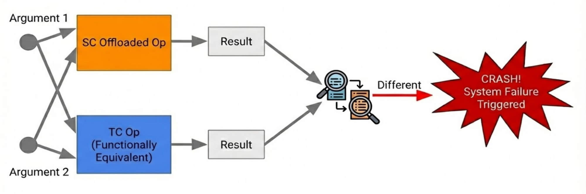

# Sparsecore Mismatch Detector

The XLA compiler can push (offload) certain ops off TensorCore onto SparseCore,
so the two units run in parallel. When these operations are offloaded, several
types of failures can manifest. The SparseCore mismatch detector tool allows
users to diagnose potential failures and identify exactly which offloaded
operations are responsible for these failures.

The detector works with a variety of operations, including collective operations
(`all-gather`, `all-reduce`, `reduce-scatter`), as well as `gather`, `scatter`,
`sort`, `copy`, and others.

## Understand how the mismatch detector tool works

The mismatch detector was initially developed for SparseCore offloaded
collective operations. The core principle is that for each SparseCore offloaded
operation, the tool creates a functionally equivalent TensorCore operation that
uses the same operands and runs on the TC thread. This approach provides a
direct comparison between the SparseCore implementation and its TensorCore
equivalent, identifying when an offloaded operation produces incorrect results.
If the results diverge, the system will either log the mismatch or crash,
depending on the configuration flags.



## Sample HLO code

To illustrate how the mismatch detector transforms the HLO (High Level
Operations) code, consider this example of an all-gather operation.

Before the mismatch detector is applied:

```
%color_operand.1 = f32[8,256,256]{2,1,0:T(8,128)} broadcast(%convert), dimensions={}
%constant = s32[8]{0:T(128)} constant({0, 1, 1, -1, 1, 0, 0, -1})
%all-gather.2.cloned.call-start = ((f32[8,256,256]{2,1,0:T(8,128)}, s32[8]{0:T(128)}), f32[16,256,256]{2,1,0}, u32[]) async-start(%color_operand.1, %constant), async_execution_thread="sparsecore", calls=%async_computation, metadata={op_type="AllGather" op_name="ag0"}
%all-gather.2.cloned.call-done = f32[16,256,256]{2,1,0} async-done(%all-gather.2.cloned.call-start), metadata={op_type="AllGather" op_name="ag0"}
```

After the mismatch detector is applied:

```
%color_operand.1 = f32[8,256,256]{2,1,0:T(8,128)} broadcast(%convert), dimensions={}
%all-gather = f32[16,256,256]{2,1,0} all-gather(%color_operand.1), replica_groups={{0,1}}, dimensions={0}
%constant = s32[8]{0:T(128)} constant({0, 1, 1, -1, 1, 0, 0, -1})
%all-gather.2.cloned.call-start = ((f32[8,256,256]{2,1,0:T(8,128)}, s32[8]{0:T(128)}), f32[16,256,256]{2,1,0}, u32[]) async-start(%color_operand.1, %constant), async_execution_thread="sparsecore", calls=%async_computation, metadata={op_type="AllGather" op_name="ag0"}
%all-gather.2.cloned.call-done = f32[16,256,256]{2,1,0} async-done(%all-gather.2.cloned.call-start), metadata={op_type="AllGather" op_name="ag0"}
%call.3 = pred[] call(%all-gather, %all-gather.2.cloned.call-done, %constant.1, %constant.2), to_apply=%all_close
%not.2 = pred[] not(%call.3)
%custom-call.8 = token[] custom-call(%not.2, %call.3, %call.3), custom_call_target="xla-tpu-log", custom_call_has_side_effect=true, backend_config={"flag_configs":[],"scoped_memory_configs":[],"used_scoped_memory_configs":[],"log_config":{"severity":"LOG_INFO","tag":"Found Mismatch in offloaded op all-gather.2.cloned.call-start:  ","extra_args":[],"opcode":"LOG_OPCODE_MESSAGE"}}
```

Notice how the transformed version adds a TensorCore all-gather operation
(`%all-gather`), a comparison using an `all_close` function (`%call.3`), and a
custom call for logging mismatches.

## Evaluate comparison results

To determine whether SparseCore and TensorCore results match, consider the
nature of the operation being tested. For operations that don't involve
computations—such as all-gather, sort, and copy—we can expect an exact match
between the results. Any difference in these cases indicates a clear problem.

However, for operations that do involve computations—such as all-reduce,
reduce-scatter, and scatter—we expect the results to be close but not
necessarily identical. This is because floating-point arithmetic can produce
slightly different results when executed on different hardware or in different
orders. For these operations, the tolerance parameters `atol` (absolute
tolerance) and `rtol` (relative tolerance) define what "close" means.
Specifically, two values are considered close if
`abs(a-b) <= atol + rtol*abs(b)`. The `all-close` check is performed for each
element of each result shape.

## Handle numerical edge cases

Several edge cases require special handling in the mismatch detector.

*   When dealing with NaN (Not a Number) values, the TensorCore result may also
    contain NaN values. In such cases, NaN values at the same position in both
    results are excluded from comparison, since `NaN != NaN` by definition in
    floating-point arithmetic.
*   Similarly, for `Inf` (infinity) values, the TensorCore result may also have
    infinity values. When the same infinity (positive or negative) appears at
    the same position in both results, it is excluded from comparison.
*   Sort operations present a challenge due to differences in sort stability.
    SparseCore uses radix sort, which is stable (preserving the relative order
    of equal elements), while TensorCore's bitonic sort is unstable. To ensure
    fair comparison, the TensorCore sort must also be made stable, for example
    by using an iota operand as a tiebreaker.

## Configuration flags

The mismatch detector is controlled through several configuration flags:

**Required flags:**

*   `xla_tpu_enable_sparse_core_mismatch_detector=true`: Use this flag to enable
    the mismatch detector tool.
*   `xla_tpu_enable_log_recorder=true`: Enables the LLO logger to capture
    SparseCore runtime trace logs. You MUST enable the LLO logger to see the
    mismatch reports in all cases.

**Optional flags:**

*   `xla_tpu_sparse_core_mismatch_detector_on_specified_ops`: If you know the
    type of the potentially offending op(s), use this flag to filter which
    operations to check. For example, to check only all-gather and sort
    operations, pass
    `--xla_tpu_sparse_core_mismatch_detector_on_specified_ops='all-gather,sort'`
*   `xla_tpu_sparse_core_mismatch_detector_crash_on_mismatch`: To halt the
    program immediately upon the first detected mismatch, set this flag to
    `true`. The error message will include the name of the specific op instance
    that failed the check. If this flag is set to `false`, the mismatch detector
    tool will perform an exhaustive search and report all mismatches without
    halting.
*   `xla_tpu_sparse_core_mismatch_detector_atol`: Sets the absolute tolerance
    for comparisons (Default: `1e-8`)
*   `xla_tpu_sparse_core_mismatch_detector_rtol`: Sets the relative tolerance
    for comparisons (Default: `1e-8`)

## Usage

We recommend the following steps when using the mismatch detector to debug.

*   **Identify the problematic op**: First, try to narrow down which SparseCore
    op is causing the unexpected results. The mismatch detector currently
    supports instrumentation for these ops:
    *   Collectives: all-gather, all-reduce, reduce-scatter
    *   Compute Ops: gather, scatter, sort, copy
*   **Run your program with the mismatch detector enabled:**
    *   **For JAX workloads on Cloud TPU:**

```sh
# Enable mismatch detector
export LIBTPU_INIT_ARGS="--xla_tpu_enable_sparse_core_mismatch_detector=true \
                         --xla_tpu_enable_log_recorder=true"

# Optional: Enable HLO dumps for debugging. This is highly recommended.
# Dumps help verify which operations are being offloaded and provide context if mismatches occur.
export XLA_FLAGS="--xla_dump_to=/tmp/xla_dump --xla_dump_hlo_as_text"
mkdir -p /tmp/xla_dump

# Run your JAX program
python3 your_jax_sparse_core_program.py
```

*   **For PyTorch:**

```sh
# Set environment variables to enable SparseCore offloading
export XLA_FLAGS="--xla_tpu_enable_sparse_core_mismatch_detector=true \
                  --xla_tpu_enable_log_recorder=true"

# Create a directory for HLO dumps
mkdir -p /tmp/xla_dump

# Run your PyTorch program
python3 your_pytorch_sparse_model.py
```

*   **Interpreting output:** If a mismatch is detected, you will find a log
    message similar to the following:

```sh
Found Mismatch in offloaded op all-gather.2.cloned.call-start: ...
```

## What to do next

If the SparseCore mismatch detection tool flags a numerical or structural
mismatch, the root cause is typically an **XLA compiler bug** during operation
offloading rather than an error in your model definitions.

Follow these steps to unblock your pipeline and report the issue:

1.  **Isolate the affected operation:** Examine the mismatch detection logs to
    identify which specific layer or XLA operation triggered the divergence.
2.  **Apply the workaround (Disable op offloading):** Modify your compilation
    settings to prevent XLA from offloading the problematic operation(s) to
    SparseCore. Running these specific ops on standard TPU cores allows your
    workload to continue running accurately while minimizing performance impact.
3.  **Report the XLA compiler bug:** File an issue to the
    [XLA issue tracker on GitHub](https://github.com/openxla/xla/issues). Attach
    the mismatch detection tool output, your model setup, and relevant HLO dumps
    so the compiler team can reproduce and fix the underlying bug.
