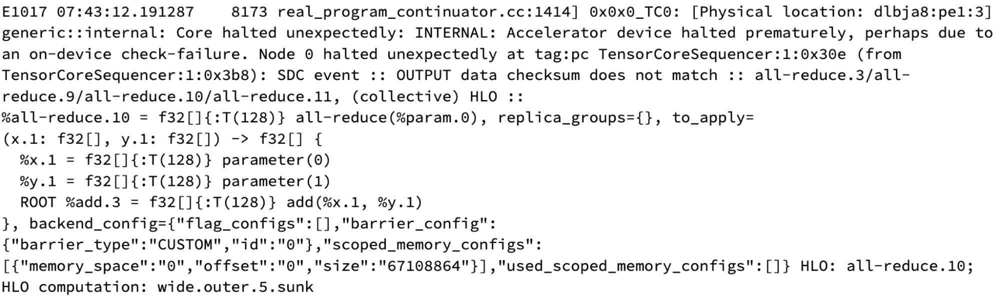
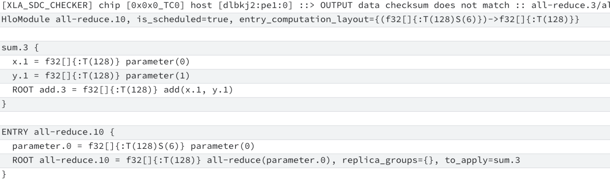
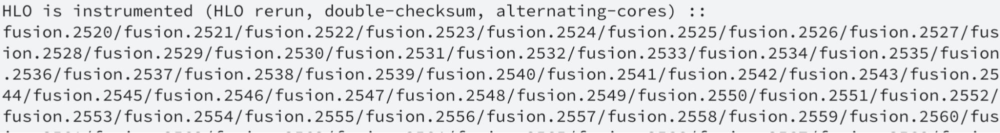

# XLA Silent Data Corruptions Checker

**XLA SDC checker (XSC)** is a set of XLA instrumentations (flags) designed to
help detect some cases of silent data corruptions (SDC) on a TPU.

It is designed to detect non-deterministic corrupt outcomes of the execution (of
the same instructions on the same data), which makes it a useful debugging tool.
It can also detect NaN/Inf values in the results.

## Quickstart: Run model with SDC checker

You can run a model with an SDC checker enabled to hopefully identify potential
SDCs early by passing the following flags to the TPU worker:

```sh
# Enable SDC Checker during model run
--xla_tpu_enable_sdc_checker=true
```

**NOTE:** The tool impacts performance significantly, so running a model with
this flag on is not practical, but it is possible to enable the tool only on
some steps (by the framework above XLA), or run a few steps before the main
training.

### Default reports (logs) of SDC events

When the SDC checker detects an error (like an output checksum mismatch) the TPU
program stops and the error is written into the TPU worker's log.
Closely, the information reported looks like this:



Here:

*   **`rs/15`** is the host in the slice the SDC was detected on
*   **`OUTPUT data checksum does not match`** is the fingerprint of the SDC
    reported by the SDC checker, followed by information about the HLO/LLO
    details to be used to locate the failure point
*   **`3x3x1_TC0`** specifies the chip and TensorCore the SDC was detected
*   **`Physical location`** gives details about where it is located

## HLO re-run

Enabled by default, this involves instrumenting some HLOs, such that the same
HLO is executed two or more times on the same inputs, and asserting that the
results from all runs are identical. The assertion is based on the checksum of
the output data.

You can increase the number of repeats with the following flag:

```sh
--xla_tpu_sdc_check_repeat_count=N # By default N=1
```

Increasing the number of re-runs may increase the chances of reproducing some
rare cases of non-determinism.

**NOTE:** When the flag is set to N>0, XSC cannot instrument asynchronous
operations since one cannot execute operation start or done twice.

## Silent reporting of SDC events

By default, your program will crash when an SDC event is detected.

With the following flag set, XSC will instrument code to NOT crash the TPU
program on SDC event detection, but **log SDC event data to the program log and
continue program execution**. This option allows collecting more than one SDC
instance during TPU program execution.

```sh
--xla_tpu_sdc_check_halt_on_detection=false # Default: true
```

**Example output:**



## Fine-level HLO filtering

By default, all HLOs are included in instrumentation. Filtering for certain HLOs
can aid in localizing the problematic HLO or removing false positives. You can
filter HLO with the following flag:

```
--xla_tpu_sdc_checker_extra_filter=...
```

**Setting the flag:**

*   The value of a flag is a sequence of regexp-like clauses separated with `;`.
*   The rules are either allowlist rules (starting with `+`, optional) or
    denylist rules (starting with `-`).
*   Rules are case insensitive.
*   Rules are applied in the order they are specified in the string:
    *   `tlp` means TLP outside of any HLO
    *   `<regex>` specifies a rule for an HLO name, it will be applied as a full
        match of the HLO name, same as if it were `^<regex>$`.
    *   `*` means any HLO name including TLP

**Examples:**

*   `“*”` - all HLOs or TLP are allowed,
*   `“”` - same as above,
*   `“-”` - the same as “-*”,
*   `“.*”` - HLOs are allowed but TLP is not considered,
*   `“all-reduce.;-”` - only allows all-reduce HLOs,
*   `“-all-reduce.123;all-reduce.;-”` - all-reduces except for all-reduce.123.

## Working with deduplicated HLOs

When XLA knows that the result of compilation of some HLOs will be exactly the
same, it compiles them only once and reuses the code between all of them, a set
of equivalent HLOs is usually called deduplicated HLOs and only instrumented
once:



When an SDC Event is being reported it mentions all deduplicated HLOs since
there is no way of distinguishing them, but for understanding what exact HLO
actually produced the SDC event, it is usually useful to disambiguate them.
Passing the following flag helps to compile all HLOs without deduplication:

```sh
--xla_jf_hlo_deduplication_all_unique=true
```

This may result in significant increase in compilation time and program size in
some cases (with possibility of OOM). To mitigate that effect, it is recommended
to specify exact names of HLOs to not deduplicate based on the SDC events being
investigated:

```sh
--xla_jf_hlo_deduplication_all_unique_filter='fusion25.*'
```

## Checking HLO with aliasing

XSC does not copy inputs before rerun and assumes them to be unchecked, so it
cannot instrument HLOs with aliased input/output. You can use the following flag
to force HLOs specified by this filter to not have aliasing (unless HLO requires
it).

```sh
--xla_tpu_disable_aliasing_extra_filter=...
```

## Change checksum algorithm

XSC supports two checksum algorithms: 'xor' and a variation of 'siphash13'. The
default algorithm is a simple xor which proved to be most efficient with enough
precision for most of the cases.

"SipHash 1-3" may be enabled when it is known that xor checksum won't be good
for the particular data sets, or when there is a suspicion for that. To do so,
set the flag:

```sh
--xla_tpu_sdc_checker_checksum_algo='siphash13'
```

## Performance Impact

It is expected that executing many HLOs several times along with computing
output checksums may significantly increase the execution time. Currently, we do
not focus on performance and execution time increase may be as large as about
2-2.5x on XLA benchmarks.
