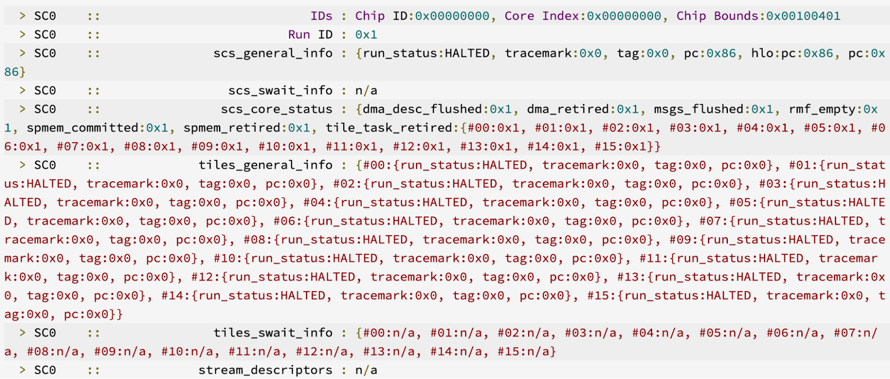

# TPU crash: Analyze core dump

When a TPU chip encounters a fatal error the execution stops, the firmware
collects some pieces of TPU's architectural state which may be useful for
debugging, such as the errors observed and other program details at the moment
of the crash.

This information is collected and serialized in a binary form, some important
information includes: instruction memory, TPU registers (sregs, pregs, dregs for
SparseCore), Smem, SyncFlags. After this binary core dump is created, XLA core
dump plugin analyzes it and prints some information which is essential for
debugging.

**NOTE:** Output of XLA core dump plugging depends on the TPU version, since
different versions of TPU may expose and require different pieces of
information, but there are pieces which are shared.

## Analyze core dumps

### Anomalies

This section reports the nature of the observed anomalies and provides codes for
each one.
![A core dump report reading "!!!! FATAL ERROR !!!! observed errors are: [USER]. Now taking a TPU core dump... Started collecting core dump..."](./images/core_dumps_anomalies.png)

Anomalies may be of different kinds. USER errors result from some user actions
which caused a hardware-level error, for example OOB memory access,
or sync flag overflow.

**Example of reported anomalies:**
![An anomalies report showing "Anomalies (2 total)" and the reports in the form of "[user] chip_die0_tc_tcs_tc_main_fatal_errors_tc_vector_program_errors1.node (first error, occurred 28841859664 cycles after reset): 0x10: sync_flag_overflow_instruction: Description unavailable"](./images/core_dumps_anomalies_report.png)

Some messages may not have relevant descriptions. In such cases, reach out to
the XLA team for support.

### TPU Cores information: TensorCore

Core dump includes core location information for one or more TensorCores on each
chip. Each chip contains information about the fingerprint and run id of the TPU
currently being executed.

It includes:

*   **Scalar PC location:** location of the scalar issue at the moment of the
    crash.
    *   Physical tag:pc represents overlay number and PC which is an IMEM
        location at or after the last executed bundle. Overlay location
        represents the logical offset of the bundle inside the overlay. When
        possible, current HLO and HLO modules are also reported.
    *   Since scalar issue runs ahead of vector issue, the PC may be located in
        the next HLO to the one where which caused the user fatal error, one can
        use an extra flag `--xla_tpu_debug_add_sfence_after_hlo` to make sure
        this does not happen.
*   **Scalar/vector error PC**, if present, indicates a location relevant to
    error in the correspondent unit, which they show depends on the nature of
    the fatal error being reported. Not all user fatal errors report error PC,
    but if reported it indicates that this particular cause caused it.
*   Few other reported fields give information on current state of TensorCore
    sync flags.
*   When symbolization was successful, core dump shows details of the HLO in a
    form of HLO module representing this HLO.

**Example:**

The following example is for TPUv7x. Note that TC1 was not executing any
program, so there is no fingerprint or core location symbolization.

### TPU Cores information: SparseCore

Core dump also includes information for one or more SparseCores on each chip in
a similar form to TensorCores.

NOTE: SC sequencer and tiles are reported separately.

**Example:**

