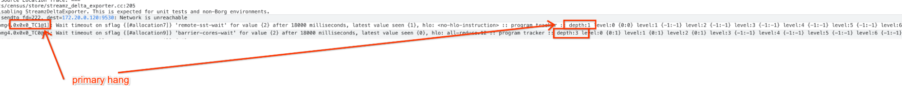
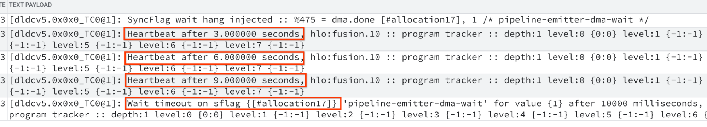

<!-- disableFinding("hang") -->
<!-- disableFinding("hung") -->

# Debugging hangs: Hierarchical program progress tracker

This auxiliary instrumentation can be used to track the progress the program has
made during execution. This information is usually used by other
instrumentations, such as [sync flag wait timeout](./sync_flag_wait_timeout.md), but may
be accessed directly.

## Description & examples

The TPU program consists of HLOs or kernels executed in some order based on
control flow of the top program level (TLP). Major HLO level control flow
primitives are
[conditional](https://openxla.org/xla/operation_semantics#conditional) and
[while](https://openxla.org/xla/operation_semantics#while) HLOs.

Technically, actual control flow on each of the cores (the program is executed
on) does not have to match exactly (though control flow differences must comply
with some requirements), so incrementing one counter at each *HLO of interest*,
even though possible, will have very little value since it cannot be compared
across different cores since different conditional branches may be taken and
while loops may execute different number of iterations.

**Hierarchical progress tracker solves this issue by adding an extra level of
counters for each Conditional and While loop.** Each level is represented with 2
s32 values: `{iteration, counter}`:

*   Iteration: For levels created for TLP and Conditional HLO iteration is
    always 0, and for While loop it is the loop iteration number.
*   Counter: The counter is updated on each Conditional or While HLO or any of
    *HLO of interest*. In current implementation, *HLO of interest* is any
    collective HLO or kernel.

### Example 1

1-layer hang reported via sync flag timeout instrumentation with hierarchical
progress tracker information attached:


It's clearly seen that the first kernel to hang on 4 cores is
`tpu_custom_call.1` with 1-level index of `{0:22}`. Two of the cores are waiting
for some data to arrive, but it's clear that they only get part of it. The other
two cores didn't receive anything yet, most probably because they are waiting
for the other two to finish their wait. The next two levels are secondary waits
at indices `{0, 23}` and `{0, 24}`.

### Example 2

Multiple-layer hang reported in a simple two-chip program with while loops.



The first chip to hang is usually the one with the lowest depth as shown in this
example. `0x0x0_TC1` hung on depth 1 and it eventually led to `0x0x0_TC0` to
hang on depth 3 because it was trying to barrier with `0x0x0_TC1` which hung
earlier.

## Tracker heartbeat

Passing an optional value to the following flag makes the program report
*tracker heartbeat* periodically after the number of seconds specified.

```shell
--xla_tpu_progress_tracker_heartbeat='0.5'
```

### Example output



## LLO-level progress tracker

While HLO-level tracking captures macro control flow (Conditionals, While loops,
and collective HLO boundaries), the LLO Progress Tracker instruments
fine-grained instructions inside collective HLO or kernels.

The LLO-level progress tracker can be enabled by setting the following flag:

```shell
--xla_tpu_llo_progress_tracker=true
```

The LLO progress tracker instruments low-level communication and synchronization
points. For example, barrier waits, remote DMA waits, DMA enqueues. At the
moment, the LLO progress tracker focuses specifically on inter-core and
inter-chip communication synchronizations, and neglects the local DMAs.

### Example output


Notice that to separate top-level HLO progress from intra-HLO LLO progress, an
**LLO boundary marker** (`2147483647` / `0x7FFFFFFF`) is pushed onto the tracker
stack.

Following this LLO boundary marker, similar to how the HLO progresses are
tracked, nested intra-LLO loops and predicated branch regions create additional
depth levels dynamically, where level is represented with 2 s32 values:
`{iteration, counter}`.

Each progress tracker checkpoint records a 32-bit `meta_id` to indicate the
active operation or the current progress. The metadata enum can be looked up
from the `CompilerMetadata`:

```
enum ProgressTrackerMetadata {
    HPPT_UNKNOWN = 0;
    HPPT_DMA_GENERAL = 1;
}
```

## Flags reference

*   `--xla_tpu_enable_progress_tracker`: N, where N specifies how many
    hierarchical levels to be expected, valid range: `[8, …)`
*   `--xla_tpu_progress_tracker_heartbeat`: F, where float value \> 0
*   `--xla_tpu_llo_progress_tracker`: bool, enables fine-grained LLO (intra-HLO)
    progress tracking for collective operations

## Known limitations and future work

*   Currently HLO of interest is any collective HLO or any kernel that involves
    communication, and the feature is mostly intended for debugging hangs which
    happened in collectives, we'll be extending this to local HLOs and hangs in
    future releases.
*   The `ProgressTrackerMetadata` contains limited instructions like DMA
    general. We’ll be extending the metadata to support a broader range of
    instruction types with richer information.
